  <picture>
    <source media="(prefers-color-scheme: dark)" srcset="./dark.svg">
    <source media="(prefers-color-scheme: light)" srcset="./light.svg">
    
  </picture>

<h2>Hey, I'm Alankrita 👋</h2>

I'm a Computer Science and Engineering student at **IET Lucknow**, building my skills across **Java, data structures and algorithms, full-stack development, and AI-enabled applications**.

I enjoy turning concepts into working projects, strengthening my problem-solving fundamentals, and learning by building.

### Current focus
- **DSA with Java** — writing clearer solutions and improving problem-solving.
- **Full-stack development** — building applications across frontend, backend, and databases.
- **AI-enabled applications** — exploring practical ways to integrate AI into useful tools.

### Selected projects
| Project | What it explores |
|---|---|
| [AI Mock Interviewer](https://github.com/12alankrita11srivastava2610-droid) | Interview-practice application using React, Express, and Mongoose. |
| [Cognexa](https://github.com/12alankrita11srivastava2610-droid) | React and TypeScript workspace for memories, knowledge, and an AI assistant. |
| [AI Study Planner](https://github.com/12alankrita11srivastava2610-droid) | Study-planning project exploring a PHP dashboard and AI planning flow. |

> Project links currently point to the GitHub profile because individual repository URLs have not been confirmed. Replace each with its exact repository URL when ready.

### Engineering stack
**Languages:** Java · Python · JavaScript  
**Frontend:** HTML · CSS · React · TypeScript · Tailwind CSS  
**Backend:** Node.js · Express · PHP  
**Databases:** MongoDB · MySQL

### Connect
- **GitHub:** [12alankrita11srivastava2610-droid](https://github.com/12alankrita11srivastava2610-droid)
- **LinkedIn:** [Alankrita Srivastava](https://www.linkedin.com/in/alankrita-srivastava-45b3b53a5/)

---

Learning in public. Building consistently. Improving one commit at a time.
