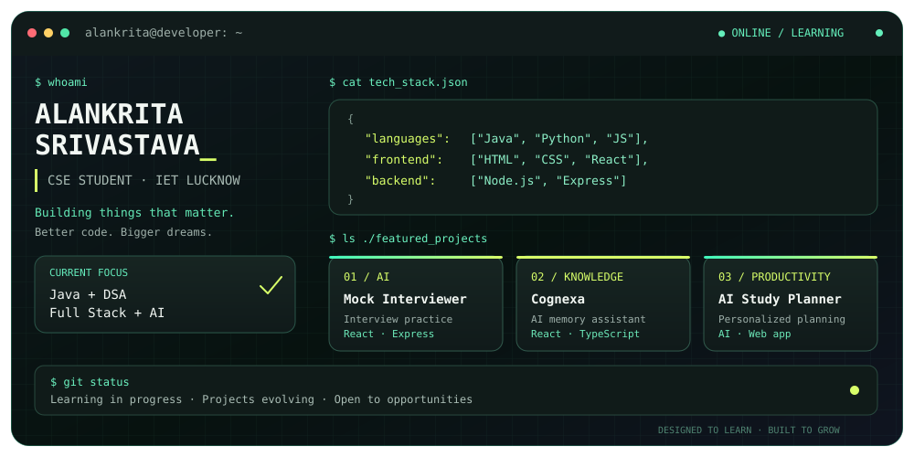

  

  <h3>Computer Science Student · Developer · Problem Solver</h3>

  

    
    
  

---

## `> whoami`

I'm **Alankrita Srivastava**, a B.Tech Computer Science and Engineering student at **IET Lucknow**, with a diploma background in Information Technology.

I enjoy solving programming problems, developing web applications, and exploring how AI can make software more useful.

- 🎓 Studying Computer Science and Engineering at IET Lucknow
- ☕ Practising Data Structures and Algorithms using Java
- 🌐 Building full-stack web applications
- 🤖 Exploring AI-powered applications and intelligent tools
- 🎯 Working towards becoming a well-rounded software engineer

---

## `> tech_stack`

### Languages

  
  
  
  
  

### Frontend

  
  

### Backend and databases

  
  
  
  
  

### Tools

  
  
  

---

## `> featured_projects`

### 01. AI Mock Interviewer

An AI-assisted interview practice application intended to help users practise interviews and receive feedback.

**Tech:** React · Express.js · MongoDB

### 02. Cognexa

An AI-powered knowledge and memory assistant concept with a dashboard, memory management, and knowledge graph interface.

**Tech:** React · TypeScript · Tailwind CSS

### 03. AI Study Planner

A study-planning application concept focused on structured schedules, personalized planning, and progress tracking.

**Tech:** Web development · AI integration

> Project descriptions reflect the intended functionality. Add repository links and verified features before presenting these as completed projects.

---

## `> problem_solving`

I am strengthening my problem-solving skills through consistent coding practice.

- **Primary language:** Java
- **Focus:** Arrays, linked lists, strings, trees, graphs, recursion, and dynamic programming
- **Goal:** Build strong algorithmic thinking and prepare for software engineering placements

---

## `> current_focus`

- [ ] Master placement-oriented DSA in Java
- [ ] Build and deploy full-stack projects
- [ ] Learn AI integration and practical AI application development
- [ ] Strengthen OOP, DBMS, operating systems, and computer networks
- [ ] Improve code quality, Git workflows, and project documentation

---

## `> github_activity`

  
  

  

---

## `> connect`

Interested in software development, AI applications, collaborative projects, and opportunities to learn and grow.

  
  

   

  Building · Learning · Solving

